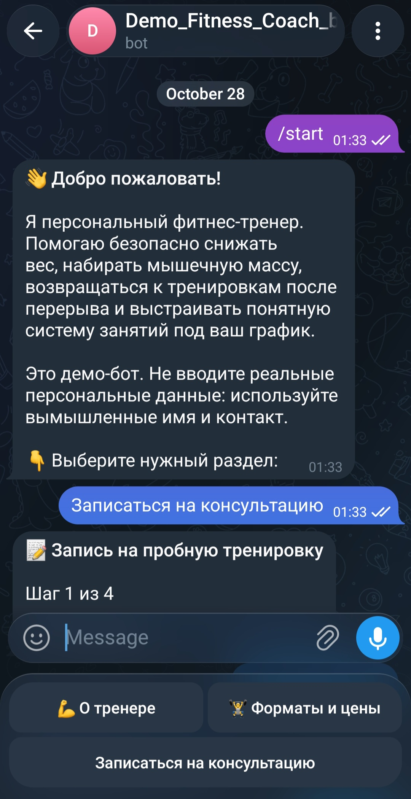
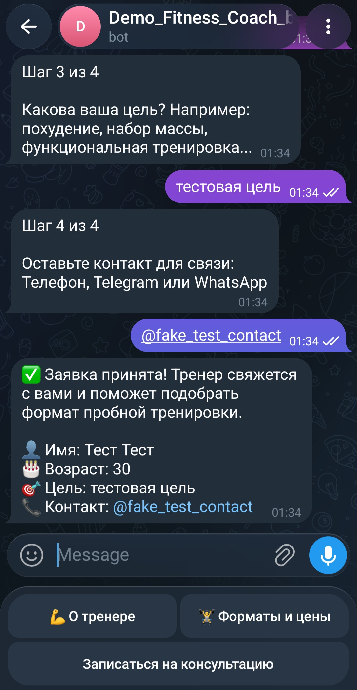
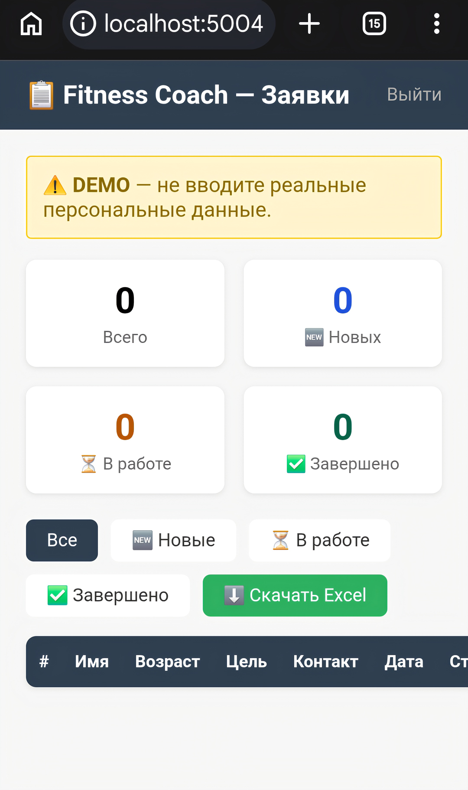

# Fitness Coach Bot

[](https://github.com/alex-yorik/fitness-coach-bot/actions/workflows/ci.yml)
[](https://github.com/alex-yorik/fitness-coach-bot/actions/workflows/quality-gates.yml)

A Telegram fitness-coach bot with an AI coach, a conversational trial-workout booking flow, a lightweight mini-CRM for the trainer, and a secured web admin panel. The bot and the admin panel run as two services from a single Docker image and share one SQLite database.

**Live demo:** [@Demo_Fitness_Coach_bot](https://t.me/Demo_Fitness_Coach_bot) (prototype only, do not enter real personal data)





## About the Development Process

This project was developed under the direction of its owner, who acted as the project lead and AI development orchestrator. The owner defined the requirements, system constraints, architecture-level decisions, task breakdown, and acceptance criteria; coordinated AI coding agents; reviewed their output; and directed testing, security checks, and quality improvements. AI agents assisted with code implementation, analysis, and testing under human direction. The owner remained responsible for technical decisions, validation, and final acceptance of the delivered work.

## Key Features

- **AI-powered fitness coach** with a Telegram-native conversational interface.
- **Trial-workout booking flow** built on a multi-step `ConversationHandler` with per-step validation and back/cancel support.
- **Mini-CRM in Telegram** with commands such as `/crm`, `/all`, and `/stats`.
- **Web admin panel** with authentication, status filtering, record management, and Excel export.
- **Non-blocking application writes:** SQLite application-saving operations run through `asyncio.to_thread`, keeping synchronous database writes off the bot's event loop.
- **Built-in rate limiting** on the admin login endpoint (`flask-limiter`, 5 POST requests per minute per IP).
- Telegram trial submission: 60-second cooldown and duplicate-submission restriction.
- **XSS and Open Redirect protection** with Jinja2 autoescaping and same-origin referrer validation.
- **Fail-closed data validation** for every form answer and for application content; unknown or invalid input is rejected by default.
- **Health checks, log rotation, and atomic SQLite backups** for reliable day-to-day operation.

## Architecture & Tech Stack

- **Language:** Python 3.12
- **Bot framework:** `python-telegram-bot` v22 (async/await)
- **Web framework:** Flask 3 with `flask-limiter`, `Flask-Login`, and `openpyxl`
- **Database:** SQLite in WAL mode with `busy_timeout`, shared between services
- **Deployment:** Docker and Docker Compose
- **Quality tooling:** pytest, pytest-asyncio, pytest-cov, ruff, Bandit, Gitleaks, pre-commit

The system is split into two containers built from one image:

| Service | Container | Command | Port | Purpose |
|---|---|---|---|---|
| Telegram bot | `fitness-coach` | `python -m app.bot` | 8001 (health) | booking flow, coach content, Telegram CRM |
| Web admin | `fitness-coach-webadmin` | `python -m admin.web` | 5004 | application management, Excel export |

The data flow, storage model, and key architectural decisions are documented in [ARCHITECTURE.md](ARCHITECTURE.md).

## Quality & Security

- **186 passed, 93.67% coverage** as of 2026-11-05 (SHA: a1a8f2a) in the unit suite, with a coverage gate of at least 80% enforced in CI.
- **Strict Bandit scanning** (`bandit -r app admin -ll`) with zero HIGH-severity findings allowed.
- **Gitleaks secrets scanning** on every push and pull request.
- **Pre-commit hooks** for Ruff linting, formatting, trailing whitespace, and end-of-file normalization.
- **Modularity gate** that keeps files and functions within the project size limits.
- **Security controls** including PBKDF2 password hashing, CSRF protection, secure session cookies, parameterized SQL queries, HTML escaping, and Excel formula-injection protection.

The threat model, implemented countermeasures, and known limitations are documented in [SECURITY.md](SECURITY.md).

## Getting Started

### Prerequisites

- Docker and Docker Compose
- A Telegram bot token from [@BotFather](https://t.me/BotFather)
- Your Telegram user ID for admin notifications

### 1. Clone the repository

```bash
git clone https://github.com/alex-yorik/fitness-coach-bot.git
cd fitness-coach-bot
```

### 2. Configure the environment

```bash
cp .env.example .env
```

Fill in `.env`:

```dotenv
# Telegram
BOT_TOKEN=your_botfather_token
ADMIN_CHAT_ID=your_telegram_id

# Web admin
FLASK_USERNAME=admin
FLASK_PASSWORD_HASH=<generated below>
SECRET_KEY=<random 64-character hex>

# True when the admin panel is served over HTTPS (fail-closed)
SESSION_COOKIE_SECURE=True

# Database and logs
DATABASE_PATH=/app/data/database.db
LOG_PATH=/app/logs/bot.log
WEB_LOG_PATH=/app/logs/web.log
HEALTH_PORT=8001
```

Generate the admin password hash:

```bash
python3 -m admin.passwords
```

Copy the resulting `FLASK_PASSWORD_HASH=pbkdf2_sha256:...` value into `.env`.

### 3. Prepare data directories

The container runs as the unprivileged user `appuser` (uid 10001):

```bash
mkdir -p data logs media
sudo chown -R 10001:10001 data logs media
```

### 4. Start the services

```bash
docker-compose up -d --build
```

### 5. Verify health

```bash
docker-compose ps
curl -f http://localhost:8001/healthz   # bot
curl -f http://localhost:5004/healthz   # admin panel
```

The admin panel is available locally at `http://localhost:5004`. By default it binds to `127.0.0.1` and is not exposed to the internet.

## Telegram CRM Commands

| Command | Description |
|---|---|
| `/crm` | Show new applications |
| `/all` | Show all applications |
| `/all new` | Show only new applications |
| `/all in_progress` | Show applications in progress |
| `/all done` | Show completed applications |
| `/stats` | Show summary statistics |

## Project Structure

```text
.
├── app/
│   ├── bot.py              # entry point and handler registration
│   ├── config.py           # environment configuration
│   ├── database.py         # async SQLite access (WAL)
│   ├── content_loader.py   # cached JSON content loading
│   ├── validators.py       # fail-closed input validation
│   ├── health_server.py    # GET /healthz
│   └── handlers/           # start, pages, trial booking flow
├── admin/
│   ├── web.py              # Flask admin panel
│   └── templates/
├── content/                # bot texts and configuration
├── tests/
│   ├── unit/               # unit and integration tests
│   └── live/               # optional Telegram API tests
├── scripts/                # backup and modularity checks
├── docker-compose.yml
├── Dockerfile
├── ARCHITECTURE.md
├── SECURITY.md
└── TECH_DEBT.md
```

## Testing

Run the unit suite locally:

```bash
python -m pytest tests/unit -m "not live"
```

Run the suite with the coverage gate:

```bash
python -m pytest tests/unit -m "not live" --cov --cov-fail-under=80
```

Live tests that require the real Telegram API are marked with `@pytest.mark.live` and are skipped by default:

```bash
RUN_LIVE_TESTS=1 python -m pytest -m live
```

## License

All rights reserved. This project is published for portfolio review and evaluation; see [LICENSE](LICENSE) for details.
