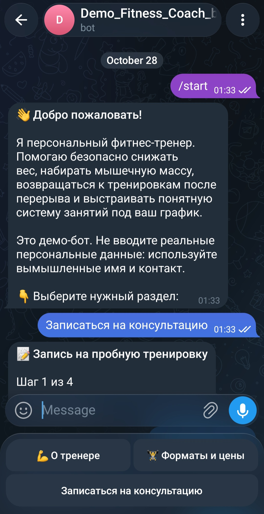
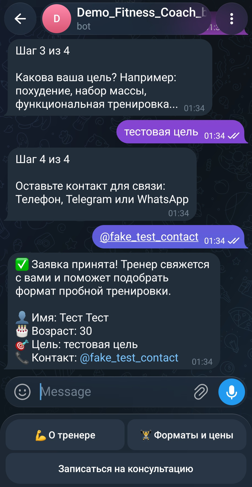
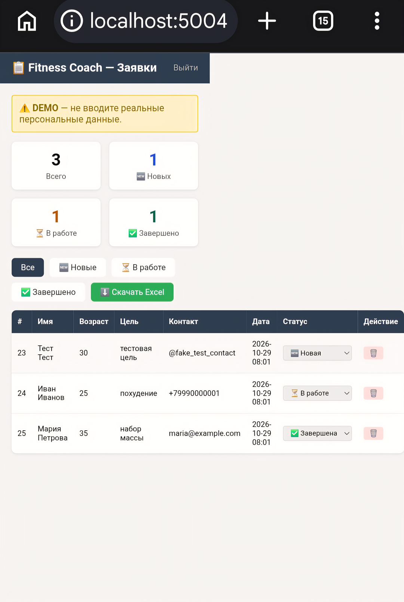

# 🏋️ Fitness Coach Bot

Telegram-бот фитнес-тренера с формой записи на пробную тренировку, мини-CRM и веб-админкой.

**Демо-бот в Telegram:** [@Demo_Fitness_Coach_bot](https://t.me/Demo_Fitness_Coach_bot) (прототип, не вводите реальные данные)

Скриншоты бота (данные вымышленные) — в папке `docs/assets/`.

## Как сделан проект

Проект создан с помощью ИИ-инструментов («вайб-кодинг»): я ставлю задачи, проверяю
поведение и принимаю решения, а код в основном генерируется ИИ. Проверки и отчёты
в репозитории (`SECURITY.md`, `ACCEPTANCE_REPORT.md`, CI) — самопроверка с участием ИИ,
а не независимый аудит. Проект является демонстрационным прототипом.

## Демо

Админка по умолчанию доступна только локально (ADMIN_BIND=127.0.0.1) и не публикуется
в интернет. Посмотреть проект можно так:

- скриншоты бота ниже (данные вымышленные);
- локальный запуск по разделу «Быстрый старт» (пароль задаёте себе сами);
- живая демонстрация по запросу (см. docs/DEMO.md).

Админка работает по HTTP, на встроенном сервере Flask, и не предназначена для реальных
клиентских данных. Для публичного доступа нужен HTTPS (через reverse proxy или туннель)
и production-WSGI-сервер; в репозиторий они не входят.

### Веб-админка (только локально)

Админка доступна только на сервере (`ADMIN_BIND=127.0.0.1`). Скриншоты:

## ✨ Особенности

- Визитка тренера с информацией об услугах и ценах
- Форма записи на пробную тренировку прямо в боте
- Мини-CRM для управления заявками в Telegram
- Веб-админка с авторизацией и выгрузкой в Excel
- Healthcheck и ротация логов (см. `docker-compose.yml`, `app/health_server.py`)

## 🚀 Быстрый старт

1. Склонировать репозиторий и скопировать шаблон окружения:

       cp .env.example .env

2. Заполнить `.env`:

       # Telegram
       BOT_TOKEN=ваш_токен_от_BotFather
       ADMIN_CHAT_ID=telegram_id_тренера

       # Веб-админка
       FLASK_USERNAME=admin
       # хеш пароля: PBKDF2-HMAC-SHA256 (600 000 итераций)
       FLASK_PASSWORD_HASH=<сгенерировать, см. ниже>
       SECRET_KEY=<случайный_64-символьный_hex>

       # True — если админка за TLS/HTTPS (fail-closed), False — только локально по HTTP
       SESSION_COOKIE_SECURE=True

       # БД и логи
       DATABASE_PATH=/app/data/database.db
       LOG_PATH=/app/logs/bot.log
       WEB_LOG_PATH=/app/logs/web.log
       HEALTH_PORT=8001

3. Сгенерировать хеш пароля админки (пароль хранится только в виде хеша):

       python3 -m admin.passwords

   Пример вывода:

       FLASK_PASSWORD_HASH=pbkdf2_sha256:600000:<salt_hex>:<hash_hex>

   Вывод записать в `FLASK_PASSWORD_HASH`.

4. Подготовить каталоги для данных и выдать их пользователю контейнера (uid 10001):

       mkdir -p data logs media
       sudo chown -R 10001:10001 data logs media

5. Запустить:

       docker-compose up -d --build

6. Проверить статус и health:

       docker-compose ps
       curl -f http://localhost:8001/healthz   # бот: 200 ok
       curl -f http://localhost:5004/healthz   # админка: 200 ok

Локально админка открывается на `http://localhost:5004`.

⚠️ `ADMIN_BIND=0.0.0.0` открывает админку всей сети; включайте только для изолированного
демо с вымышленными данными и предпочтительно за HTTPS.

## 📁 Структура проекта

    FitnessCoach/
    ├── app/
    │   ├── bot.py              # точка входа бота, регистрация хендлеров
    │   ├── config.py           # конфигурация из .env
    │   ├── database.py         # SQLite (WAL), init_db
    │   ├── keyboards.py
    │   ├── content_loader.py   # загрузка/валидация JSON-контента
    │   ├── validators.py       # валидация контента и ответов формы
    │   ├── logging_config.py   # ротация логов (10 МБ × 5)
    │   ├── health_server.py    # GET /healthz (порт 8001)
    │   └── handlers/
    │       ├── start.py
    │       ├── pages.py
    │       └── trial.py        # форма записи (ConversationHandler)
    ├── admin/
    │   ├── web.py              # Flask-админка (порт 5004)
    │   └── templates/
    ├── content/
    │   └── fitness_coach.json
    ├── scripts/
    │   ├── backup.sh           # атомарный бэкап SQLite (ротация 14 дней)
    │   └── check_modularity.py # гейт: файл ≤500, функция ≤50 строк
    ├── tests/
    │   ├── conftest.py
    │   ├── unit/               # unit-тесты (валидаторы, БД, хендлеры, web, ...)
    │   └── live/               # live-тесты Telegram API (@pytest.mark.live)
    ├── .env.example
    ├── docker-compose.yml
    ├── Dockerfile
    ├── ARCHITECTURE.md         # поток данных, хранилище, ключевые решения
    ├── SECURITY.md             # модель угроз и контрмеры
    ├── TECH_DEBT.md            # технические долги
    ├── CHANGELOG.md            # git-cliff из conventional commits
    ├── docs/
    │   ├── DEMO.md             # как показать демо без открытого порта
    │   └── assets/             # скриншоты бота и админки
    ├── ACCEPTANCE_REPORT.md    # историческая запись приёмки (ИИ-самопроверка)
    └── cliff.toml

## 🌐 Веб-админка

Локально доступна по адресу: **http://localhost:5004**

⚠️ **Доступ только с сервера.** Админка слушает только localhost (`ADMIN_BIND=127.0.0.1`).
Публичный доступ закрыт в целях безопасности. Для удалённого доступа необходим
HTTPS (reverse proxy или туннель); см. docs/DEMO.md.

Логин и пароль задаются в `.env` (логин `FLASK_USERNAME`, пароль — только в виде хеша
`FLASK_PASSWORD_HASH`).

Возможности:
- Просмотр всех заявок
- Фильтрация по статусам (новые / в работе / завершённые)
- Смена статусов и удаление
- Выгрузка в Excel

## 🤖 CRM команды в Telegram

| Команда | Описание |
|---|---|
| /crm | Новые заявки |
| /all | Все заявки |
| /all new | Только новые |
| /all in_progress | В работе |
| /all done | Завершённые |
| /stats | Статистика |

## 📊 Статусы заявок

| Статус | Значение |
|---|---|
| new | 🆕 Новая заявка |
| in_progress | ⏳ В работе |
| done | ✅ Завершена |

## 🧪 Тесты

Тесты: 10 test files, 116 test functions; последний полный прогон: 159 passed, 0 failed, покрытие 92.98% (пакеты app/ и admin/; гейт ≥ 80% в CI); подтверждено повторным прогоном 2026-10-29.

    # Быстрый прогон (unit-тесты, без сети)
    python -m pytest tests/unit -m "not live"

    # С coverage-гейтом (>=80%)
    python -m pytest tests/unit -m "not live" --cov --cov-fail-under=80

Live-тесты, требующие реальный Telegram API, помечены `@pytest.mark.live`
и по умолчанию пропускаются. Запуск только вручную:

    RUN_LIVE_TESTS=1 python -m pytest -m live

## 🤖 CI/CD

Проверки качества автоматически запускаются на каждый push/PR в `main`
(GitHub Actions, Python 3.12, < 5 мин):

| Workflow | Что проверяет |
|---|---|
| `ci.yml` | ruff check + format, py_compile всех файлов, unit-тесты, docker build |
| `quality-gates.yml` | bandit (`-ll`, 0 HIGH), secrets-скан (gitleaks), coverage ≥ 80%, модульность (`scripts/check_modularity.py`) |

В CI запускаются только unit-тесты (`-m "not live"`), live-тесты — никогда.

Рекомендуется включить branch protection для `main` с required checks.
Фактические имена проверок (выбирать из выпадающего списка):
- CI: `Lint, compile and unit tests`, `Docker build`
- Quality Gates: `Bandit + secrets scan`, `Coverage gate >= 80%`, `Modularity gate`

В ruleset галочка «Restrict updates» должна быть выключена.

### 📝 Changelog

`CHANGELOG.md` генерируется из conventional commits через `git-cliff`
(конфиг `cliff.toml`, разделы Added/Changed/Fixed/Security). Регенерировать:

    git-cliff -o CHANGELOG.md

## 🛠 Docker команды

    # Статус контейнеров
    docker-compose ps

    # Логи бота
    docker logs fitness-coach --tail=30

    # Логи веб-админки
    docker logs fitness-coach-webadmin --tail=30

    # Перезапуск
    docker-compose restart fitness-coach

    # Пересборка после изменений
    docker-compose up -d --build

### Healthcheck

Оба сервиса имеют `healthcheck` в `docker-compose.yml` (curl на `/healthz`,
интервал 300s, start_period 15s). Health-эндпоинты проверяют доступность БД:

- бот: `http://localhost:8001/healthz`
- админка: `http://localhost:5004/healthz`

По умолчанию админка закрыта (`127.0.0.1`); `ADMIN_BIND=0.0.0.0` открывает её
всей сети: только для изолированного демо с вымышленными данными, см.
`docs/DEMO.md`.

## 📝 Обновление контента

    nano content/fitness_coach.json
    docker-compose restart fitness-coach

## 🔧 Стек

- Python 3.12
- python-telegram-bot
- SQLite (WAL)
- Flask + flask-limiter
- openpyxl
- Docker + Docker Compose
- git-cliff (changelog)

## ℹ️ Быстрая справка

| Параметр | Значение |
|---|---|
| 📦 Контейнер бота | `fitness-coach` |
| 🌐 Контейнер админки | `fitness-coach-webadmin` |
| 🔌 Порт админки | **5004** |
| ❤️ Health-порт бота | **8001** |
| 👤 Логин | `admin` (из `.env`) |
| 🔑 Пароль | хеш (см. `FLASK_PASSWORD_HASH`) |
| 🗄 БД | `/app/data/database.db` (volume `./data`) |

## 📄 Лицензия

All rights reserved. Проект опубликован для портфолио и оценки; условия использования — в файле [LICENSE](LICENSE).
